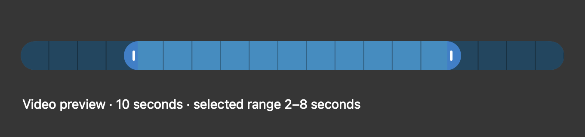
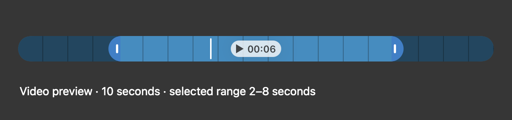
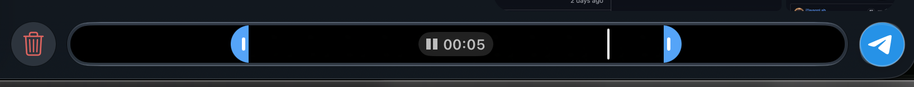
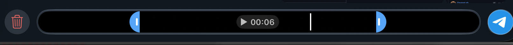

# Recording editor controls and preview playback

## Change

Paused video recordings now accept both trim handles, timeline seeking and Play/Pause. The selected fragment stops at its end and can be replayed. Discard/resume confirmations yield pointer events, cannot open twice, and cannot bring back a dismissed recording overlay.

The floating recording controls previously lived in a child window above the editor. That window could intercept the right trim handle. Editor controls now share the overlay window and sit above the floating controls, with coordinates converted through screen space when crossing windows.

Video timeline actions previously reached only the audio preview player. They now reach the video player, publish position/playback state, retain seeks until the player is ready, and reject stale seek completions. Closing the preview removes its observers and stops playback. A bounded cleanup path handles missing animation callbacks.

This patch does not implement dictation. It is independent of [PR #82](https://github.com/TelegramMessenger/telegram-macos/pull/82), which removes an unused bitmap from thumbnail preparation in the same recording-preview flow. The editor failures reproduced with and without that optimization.

## Before and after

These are captures of the real AppKit timeline component with a generated placeholder: a 10-second recording, a 2–8 second selection and position at 4 seconds. They are native fixture captures, not screenshots of a signed-in client. The comparison script switches only the timeline component to the unchanged master implementation for Before.

### Before

The video timeline hides its playback control and has no video position indicator.



### After

The same selection shows Play/Pause, its six-second duration and the video position indicator.



The images demonstrate the visible timeline change. Pointer routing, seeking, playback boundaries and dismissal are checked separately by the tests and manual workflow below.

## Full-client screenshots: PR #82 and PR #92 together

These additional screenshots are from the signed-in Telegram Master Test 13.1.0 (283357) client on current master with both PRs applied. They show the real recording bar, separate from the native fixture comparison above.

### Playing

The Pause control is visible while the selected fragment plays.



### Paused

The Play control is visible while the selected fragment is paused.



I confirmed that seeking and the playhead stay within the range selected by the left and right trim handles. Both PRs work together: preview images and thumbnails remain normal, both trim boundaries move in both directions, Play/Pause works for the full recording and selected fragment, and repeated No/Discard confirmations allow another recording to start.

## Validation

Environment: macOS 27.0.1 (26A434), Apple M4 Pro arm64, Xcode 27.1 / Swift 6.4. Current master base: `272d85dd7cc78864549b1d5510a177db79059fc7`.

- All 15 focused native tests pass: six control/trim tests, five synthetic-video playback/lifetime tests and four overlay/modal lifecycle tests.
- A full Debug arm64 application build passes on that base with this editor patch, without the PR #82 optimization.
- The playback-control visibility regression was observed failing before the fix. Both native snapshot cases also check the expected hidden/visible control state.
- The signed-in Master Test 13.1.0 (283357) workflow now also passes on current master `272d85dd7cc78864549b1d5510a177db79059fc7` with PR #82 (`362ca9f6`) and PR #92 (`5add38a4`) together. The full combined build, signature verification and the same 15 native tests pass. Live testing confirms normal preview/thumbnails, both trim boundaries and seeking within the selected range, full/selected Play/Pause, repeated No/Discard confirmations and another recording. The original independent editor test remains recorded separately in `verification.json`.

The full local build uses the repository's Xcode 27 compatibility adjustments and isolated app/profile configuration. Those adjustments are not part of this PR. Recordings were discarded without sending; successful send/upload/export and app-wide performance were not tested. See [verification.json](verification.json) for source hashes, test/build log hashes and the scope of each check.

## Reproduce

Prepare native dependencies using [INSTALL.md](../../../INSTALL.md), and apply [XCODE27.md](../../../XCODE27.md) when using Xcode 27. Run these commands from the repository root:

```sh
python3 tools/tests/recording-editor/run.py --derived-data /tmp/telegram-recording-tests --log /tmp/telegram-recording-tests.log
python3 tools/tests/recording-editor/render-comparison.py --derived-data /tmp/telegram-recording-tests --output /tmp/telegram-recording-comparison
```

The comparison script temporarily swaps the timeline source and adds its fixture to the existing test target, then restores both. Do not edit those files concurrently with the capture. The fixture uses only generated image data and does not access a Telegram account, camera or microphone.


## Camera shutdown regression, 27 October 2026

The pipeline status subscription now survives `viewWillDisappear`, so late completion, discard and failure events can still call `stopCapture()`. The subscription is disposed in `deinit`; preview-player and countdown cleanup are unchanged.

The runner compiles the current modal controller source into a temporary test fixture, replacing only its class name, capture-pipeline type and preview-view type with probes. Controller lifecycle and subscription code are taken from the production file on every run. The probes do not open a camera, microphone or Telegram account. Generated test files are removed when the runner exits; do not edit those fixture paths concurrently.

Before the fix, all three late-terminal-event tests failed while the controller remained retained; the existing 15 editor tests passed. After the one-line fix, all 18 tests pass on master `e537320b28d79cecc1baf716bcbf822b02f93b7a`. This verifies requests to stop capture before controller deallocation, not physical camera shutdown. Full-client build and physical-camera checks are pending and are recorded separately.
