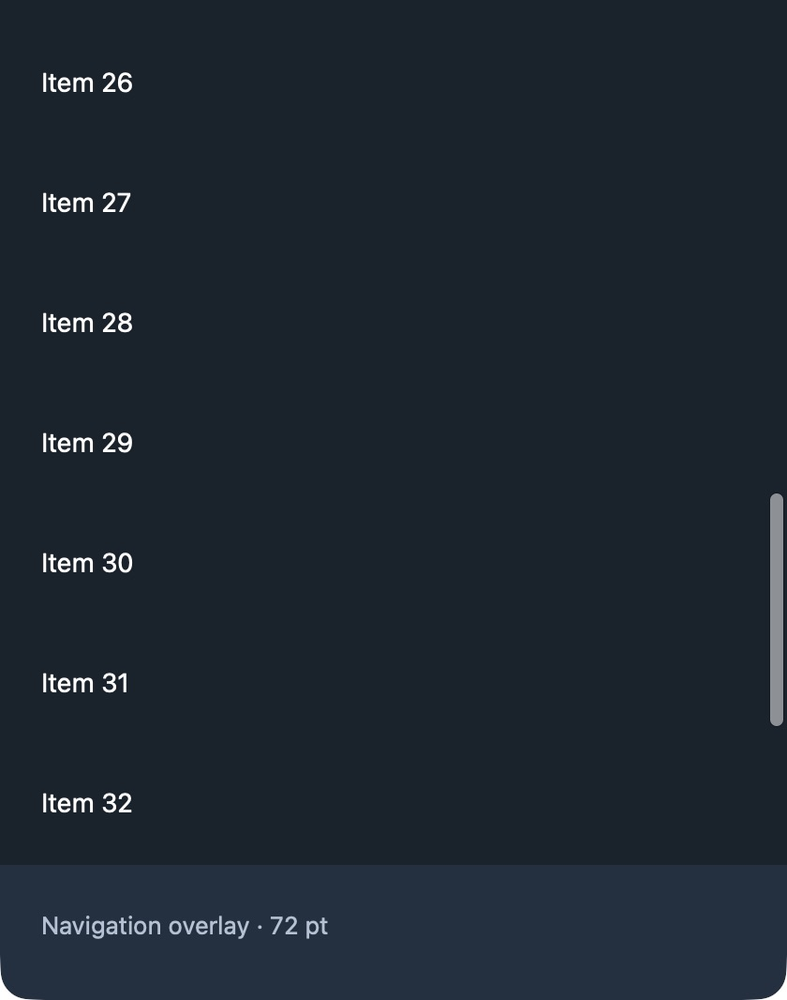
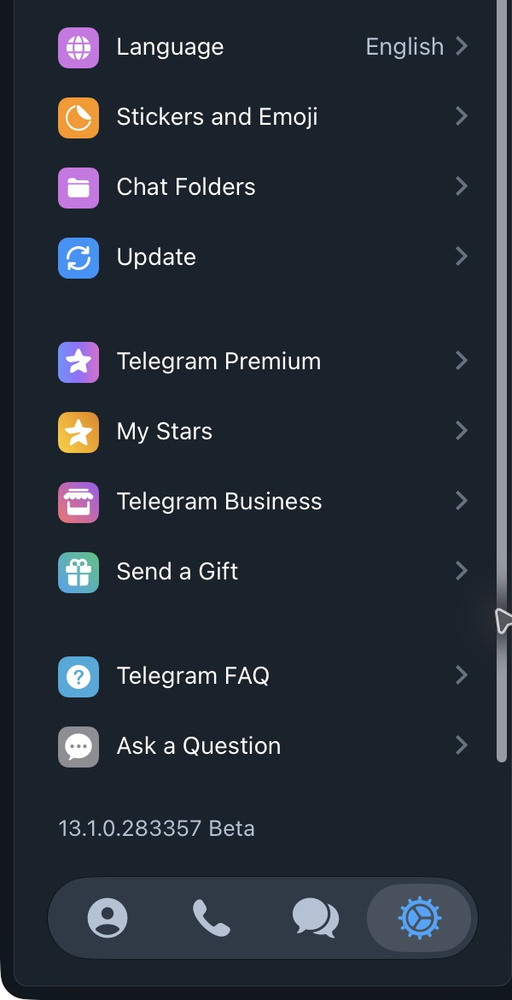

# Application scrollbar regression

`TGUIKit.ScrollView` now installs the shared native overlay scroller whenever vertical scrolling is enabled. TableView-based screens inherit it, including chats, search, settings, forms, contacts, calls, media lists and pickers. The rich-text draft preview and video-tool panel opt in through the same NSScrollView helper. Intentionally hidden scrollbars stay hidden; horizontal-only scroll views are unchanged. Self-contained editor components, web content and system dialogs retain their own scrolling implementation.

The thumb paints a rounded 3 pt line (5 pt while expanded/tracking or with increased contrast), colored from the current palette's `grayText`. Native hit geometry, dragging and auto-hide remain AppKit's responsibility. Theme updates invalidate the TableView scroller. Configuration is idempotent and preserves an existing themed instance.

## Inset audit

| Screen | Result |
| --- | --- |
| Chat list and sidebar search | Removed duplicate footer scroller inset; retained content clearance and separate header inset. |
| Account settings and recent calls | Removed the same duplicated footer inset. |
| InputData forms/settings subpages | Retained composed content padding; removed its duplicate from scroller insets. |
| Contacts | Already uses zero additional bottom scroller inset; unchanged. |
| Chat history | Preserved the top content inset and separate bottom scroller exclusion for the input panel. |
| Emoji, sticker and GIF pickers | In the entertainment host, retained the 46 pt top scroller inset and 56 pt tabs content clearance, and reset the additional bottom scroller inset to zero. Standalone picker configurations are unchanged. |

AppKit combines contentInsets and scrollerInsets while tiling its native scroller. Applying the same footer height twice makes the thumb stop one footer height above the usable list's lower boundary, even at native progress 1.

## Run

```sh
python3 tools/tests/sidebar-scroll/run.py --scratch-path /tmp/telegram-scrollbars
```

Initialize dependencies first. A full checkout can supply dependencies through `--dependency-root /path/to/telegram-macos`. Reuse the scratch path. The runner snapshots affected TGUIKit sources from the selected revision without changing the dependency checkout; other dependencies come from that checkout.

```sh
python3 tools/tests/sidebar-scroll/run.py --revision e537320b28d79cecc1baf716bcbf822b02f93b7a --scratch-path /tmp/telegram-scrollbars
```

The baseline intentionally exits nonzero. The suite extracts real inset assignments from Chats, Search, Settings, Calls, InputData and ChatController. Controlled native TableView rows avoid a network/account dependency. It covers short/long lists, 400/800 pt heights, 0/56/80 pt footer heights, chat header insets, zero-size initialization followed by layout, native progress/endpoints/hit testing, and the unflipped chat-history input-panel exclusion. AppKit's 1 pt knob end padding is retained. Candidate-only checks cover common ScrollView installation, repeat configuration, hide/re-enable, horizontal-only views and the plain NSScrollView opt-in.

Current suite: **530 checks, 0 failures**, including all three entertainment-host picker tables at the 56 pt tabs inset. See [current output](evidence/current-checks.txt). The retained [earlier regression output](evidence/regression.txt) predates the picker cases.

## Native comparison

Add `--prepare-app` to build `SidebarScrollValidation.app` in the scratch path. Quit it before building another revision. Buttons select top/bottom endpoints and dark/light palettes.

The numbered-row images are native captures using production TGUIKit and a 72 pt footer overlay, **not screenshots of authenticated Telegram content**. Both revisions use identical 420×680 pt window geometry and native scroll progress 1. Captures are cropped to the rows/footer without changing pixels inside the crop.

| Palette | Before | After |
| --- | --- | --- |
| Dark |  |  |
| Light |  |  |

The actual Telegram settings sidebar was also captured at native progress 1, with the same window and content position. The account profile is outside both crops.

| Actual client | Before | After |
| --- | --- | --- |
| Settings sidebar |  |  |

[General Settings before](evidence/client-before-general.png) · [General Settings after](evidence/client-after-general.png)

The native fixture also verified an actual mouse drag from bottom to top (native value 1 → 0), theme changes and the top endpoint.

## Full client validation

See the [build and runtime record](evidence/native-build.txt). Only the available macOS version and a Debug integration build were tested. Other macOS versions, a distribution build and the system increased-contrast preference were not exercised. Private account captures remain local; public evidence excludes the account profile and chat sidebar.

## Review follow-up

The AppKit knob slot is drawn by NSScroller again, preserving native hover/drag track feedback. Increase Contrast uses an opaque thumb and the expanded 5 pt geometry. It keeps the active palette text only when it contrasts sufficiently with the actual ancestor surface; otherwise it uses opaque white or black. Translucent panel backgrounds are composited over the theme background. The system preference itself has not yet been exercised; this is the explicit drawing policy.

Common installation, identity and horizontal-only behavior are now covered by ThemedScrollerTests in the existing TGUIKitTests target (`swift test --package-path packages/TGUIKit --filter ThemedScrollerTests`). The standalone native fixture remains necessary for per-screen extracted assignments and visible endpoint geometry; it does not run in CI automatically. The unused after-top image was removed.

The prior full-client record names an integration checkout and is historical integration evidence, not an independent build of this PR head. For independent native component reproduction the runner copies the selected PR sources into a temporary TGUIKit package and uses initialized dependencies supplied with --dependency-root. Content clearance excludes the floating footer already; scrollerInsets.bottom is the additional exclusion and must be zero there to avoid applying it twice. The changed ChatListUI test encodes that geometry; it is not maintainer approval of product design.

The palette test now checks both Telegram light/dark palettes against both Aqua/Dark Aqua appearances with expanded/collapsed thumbs. The high-contrast branch checks opaque text against the local surface; it does not resolve NSColor.labelColor from an unrelated system appearance. This exercises the drawing color policy without changing the user's accessibility preference.

The high-contrast color now checks the actual ancestor surface background, compositing translucent panels over the theme background. It keeps the palette text when that has sufficient contrast and otherwise selects opaque white/black. This covers always-dark call/editor surfaces in a light theme and light surfaces in a dark theme without following an unrelated system appearance. Five native ThemedScrollerTests pass, including black and 60%-black panels and the inverse theme/surface combination.
